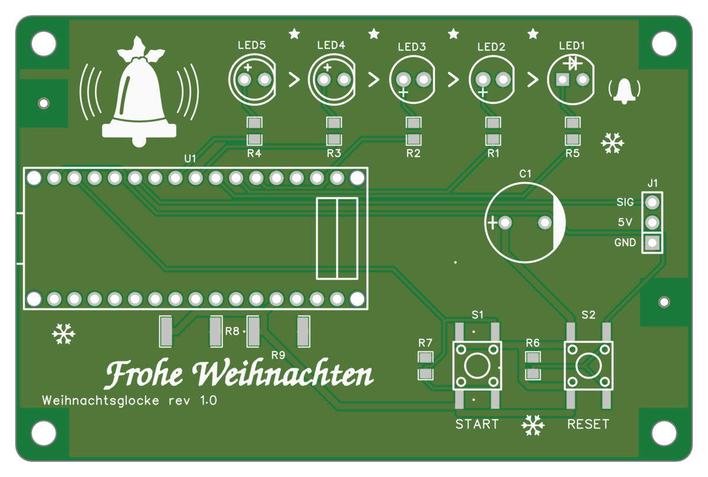

# 🎄 Weihnachtsglocke - Christkind-Klingel

**Automatische mechanische Glocke für den Christkind-Brauch an Heiligabend.**

---

## 🎯 Anwendung

An Heiligabend:
1. Eltern bereiten Geschenke am Weihnachtsbaum vor
2. Elektrische Kerzen einschalten
3. **Start-Taster drücken** → Countdown beginnt (LEDs zeigen verbleibende Zeit)
4. Eltern verlassen den Raum
5. **Nach 65 Sekunden läutet die Glocke mechanisch**
6. Kinder stürmen herein → Bescherung beginnt! 🎅✨

> ⚠️ **Wichtig:** Die Glocke wird **mechanisch angeschlagen** (kein elektronischer Ton!).

---

## 📍 Positionierung

- **Intended Position:** Buchregal oder ähnlicher erhöhter Ort
- **Servo-Arm hängt nach UNTEN**, Glocke hängt UNTEN dran
- **Weiter hinten platzieren** – Kinder sind auf den Baum fokussiert

---

## 📁 Projektstruktur

```
automatic_christmas_bell/
├── README.md              # Anwendung & Flash-Anleitung (dieses Dokument)
├── src/
│   └── firmware/
│       └── buttons.ino     # Arduino-Sketch
├── platformio.ini         # PlatformIO-Konfiguration
├── Makefile               # Arduino CLI; make publish = Fertigungsdateien veröffentlichen
├── tools/
│   └── edakit             # findet edakit für Hook und Makefile; make publish = edakit release publish
├── .githooks/pre-commit   # edakit check, sim, graph json --check je Platine (git config core.hooksPath .githooks)
├── hardware/              # Hauptplatine (edakit): Graph (graph.toml), Bauteile, Freigaben
│   └── img/
│       └── silkscreen_top.png  # Bestückungsplan (Silkscreen)
├── variants/              # Platinen smd, tht, esp32, esp32tht; Bestellen: variants/README.md
├── docs/
│   ├── decisions.md       # Entscheidungen D-1 …
│   ├── organisation.md    # Was wo liegt und wer es pflegt
│   └── old/               # Historie: IMPLEMENTIERUNG.md, Fritzing
│       ├── weihnachtsglocke.fzz
│       ├── weihnachtsglocke_Schaltplan.png
│       └── weihnachtsglocke_Schaltplan.svg
├── LIZENZ                # MIT Lizenz
└── AGENTS.md              # Agent-Konfiguration
```

---

## 🔧 Hardware (Übersicht)

- **Arduino Nano** (oder LILYGO T-Display auf den ESP32-Platinen) – Mikrocontroller
- **Servo 9g** – Betätigt die Glocke mechanisch
- **5 LEDs** – Visueller Countdown (2× Grün, 2× Gelb, 1× Rot)
- **2 Taster** – Start und Reset
- **Echte Glocke** – Wird vom Servo angeschlagen

**Pin-Belegung:**
- **Taster Start:** Pin 11
- **Taster Reset:** Pin 12
- **LED Grün 1:** Pin 6
- **LED Grün 2:** Pin 5
- **LED Gelb 1:** Pin 2
- **LED Gelb 2:** Pin 3
- **LED Rot:** Pin 4
- **Servo:** Pin 8

**Bestückungsplan (Silkscreen Top View):**



---

## ⚡ Schnellstart

### 1. Position wählen
- Im Buchregal oben befestigen
- Servo mit nach unten hängendem Arm an Glocke anbringen

### 2. Hardware aufbauen
- Schaltplan: Siehe `docs/old/weihnachtsglocke_Schaltplan.png`
- Stromversorgung: alles über die USB-Buchse des Moduls (Powerbank oder USB-Netzteil); das Servo hängt am 5V-Pin des Moduls (D-3)
- Platinen: Fertigungsdateien (Gerber, BOM, CPL) unter [Releases](https://github.com/tgd1975/automatic_christmas_bell/releases);
  Aufbau in [hardware/README.md](hardware/README.md) und [variants/README.md](variants/README.md)

### 3. Software hochladen (3 Optionen)

#### **🔹 Option A: Arduino IDE (einfachste Methode)**
```
1. Arduino IDE installieren: https://www.arduino.cc/en/software
2. Sketch öffnen: File → Open → src/firmware/buttons.ino
3. Board auswählen: Tools → Board → Arduino Nano (oder Uno)
4. Port auswählen: Tools → Port → /dev/ttyACM0 (oder COM3 auf Windows)
5. Hochladen: Klick auf den Pfeil-Button (Upload)
```

#### **🔹 Option B: PlatformIO (empfohlen für Teams & Abhängigkeiten)**
```bash
# 1. PlatformIO installieren (VS Code Extension oder CLI)
# 2. Projekt öffnen
pio run -e nano      # Für Arduino Nano
pio run -e uno       # Für Arduino Uno
pio run -t upload    # Hochladen
pio run -t monitor   # Serial Monitor öffnen (115200 Baud)
```

#### **🔹 Option C: Arduino CLI & Makefile (für Terminal-Fans)**
```bash
# 1. Arduino CLI installieren
#    Mac: brew install arduino-cli
#    Linux: sudo apt install arduino-cli
#    Windows: choco install arduino-cli

# 2. Board-Definitionen laden
arduino-cli core install arduino:avr

# 3. Kompilieren & Hochladen
make                    # Standard (Arduino Uno)
make BOARD=arduino:avr:nano upload  # Für Arduino Nano
make PORT=/dev/ttyUSB0 upload        # Spezifischer Port

# 4. Serial Monitor
make monitor
```

---

## 📶 Variante ESP32: Display und Webseite

Die Platine mit dem LILYGO T-Display ([variants](variants/README.md)) zeigt den Countdown auf ihrem Display und hat
eine Webseite: Status, Zeit bis zum Läuten, Start, Pause, Stopp und Timer.

1. **Erster Start:** Die Glocke öffnet den Hotspot `Glocke-XXXX`, Name und Passwort stehen auf dem Display.
2. Mit dem Handy verbinden – die Einrichtungsseite öffnet sich (sonst http://192.168.4.1).
3. Heim-WLAN wählen, Passwort eingeben, speichern.
4. Danach: **http://glocke.local** (die Adresse steht auch auf dem Display).

| Taste | Wirkung |
|---|---|
| Start | Countdown starten, nach Pause weiter |
| Reset | Stopp |
| Start halten + Reset | sofort läuten |
| Reset 3 s halten, loslassen | WLAN an/aus (grüne LEDs leuchten) |
| Reset 10 s halten, loslassen | WLAN vergessen, Hotspot öffnet sich (rote LED leuchtet) |

---

## 📖 Detaillierte Dokumentation

Die Platinen und ihre Umsetzung: **[hardware/README.md](hardware/README.md)**, die Varianten in
**[variants/README.md](variants/README.md)**, die Entscheidungen in **[docs/decisions.md](docs/decisions.md)** und was
die Schaltung können muss in **[hardware/requirements.toml](hardware/requirements.toml)**. Die erste Umsetzung aus der
Fritzing-Zeit liegt als Historie in [docs/old/IMPLEMENTIERUNG.md](docs/old/IMPLEMENTIERUNG.md).

---

## 🔧 Troubleshooting

### **Häufige Probleme & Lösungen**

| **Problem** | **Ursache** | **Lösung** |
|------------|-------------|------------|
| **Board nicht erkannt** | Falscher Port | `ls /dev/tty*` (Mac/Linux) oder Gerätemanager (Windows) prüfen |
| **Upload fehlgeschlagen** | Falsches Board | Richtiges Board in IDE/PlatformIO/Makefile auswählen |
| **Servo zuckt nur** | Strommangel | Stärkere USB-Quelle (Nano: USB-Port mit 500 mA, ESP32: Netzteil oder Powerbank mit mindestens 1 A) und ein kurzes Kabel; eine getrennte Servo-Versorgung sieht die Platine nicht vor (D-3) |
| **LEDs leuchten nicht** | Falsche Pin-Belegung | Pin-Definitionen in `buttons.ino` prüfen |
| **Serial Monitor zeigt nichts** | Falsche Baudrate | 115200 Baud einstellen |
| **Code kompiliert nicht** | Fehlende Bibliothek | `arduino-cli lib install Servo` |

### **Debug-Output aktivieren**
Der Code sendet Debug-Informationen über Serial:
- **Countdown-Phasen** (`countdown phase 0-4`)
- **Button-Events** (`pressed A`, `pressed B`)
- **Servo-Positionen** (`reached angleto`, `reached anglefrom`)

Öffne den Serial Monitor mit **115200 Baud** um den Status zu verfolgen.

---

## 🛠️ Anpassungen

### **Countdown-Zeit ändern**
In `src/firmware/buttons.ino`:
```cpp
const long countdowntime = 60;    // Sekunden für Countdown
const long finalwarningtime = 5; // Sekunden für Endwarnung
```

### **Servo-Winkel anpassen**
```cpp
const int SERVO_MIN_ANGLE = 60;    // Minimalwinkel
const int SERVO_MAX_ANGLE = 110;   // Maximalwinkel
const int SERVO_REST_ANGLE = 85;   // Ruheposition
```

### **LED-Pins ändern**
```cpp
const int ledGreen1 = 6;
const int ledGreen2 = 5;
const int ledYellow1 = 2;
const int ledYellow2 = 3;
const int ledRed = 4;
```

---

## 📜 Lizenz

[MIT Lizenz](LIZENZ) – Freie Nutzung, Modifikation und Verteilung.

---

**Frohe Weihnachten! 🎄🔔**

> *"Wenn die Glocke läutet, kommt das Christkind!"*
