# Aufbau der THT-Glocke – löten und in Betrieb nehmen

Schritt-für-Schritt-Anleitung für die beiden Platinen, die unbestückt kommen:

- **THT** (Arduino Nano) – [variants/tht](../variants/tht)
- **ESP32 THT** (LILYGO T-Display) – [variants/esp32tht](../variants/esp32tht)

Auf beiden liegen alle Teile am selben Platz, nur das Modul U1 und die Widerstände R6/R7 nicht. Was nur für eine
Platine gilt, steht mit **[THT]** oder **[ESP32 THT]** dabei. Die Bilder sind die Ansichten der bestellten Fassung
(rev 1.0).

| THT (Nano) | ESP32 THT (T-Display) |
|---|---|
| 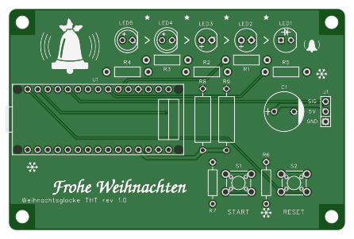 | 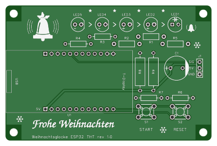 |

**Richtungen:** „oben“, „unten“, „links“, „rechts“ meinen immer den Blick auf die **bedruckte Seite** wie im Bild –
LED-Reihe oben, USB-Ende des Moduls links, J1 rechts. Alle Teile stecken von der bedruckten Seite, gelötet wird auf
der Rückseite. Dort ist links und rechts vertauscht und es gibt keinen Druck
([THT](img/aufbau_tht_unten.svg), [ESP32 THT](img/aufbau_esp32tht_unten.svg)).

Zum Ausdrucken baut `uv run docs/aufbau.py` diese Seite als `build/aufbau/aufbau.pdf`; das Skript zeichnet
auch die Farbringe und die Messbilder.

**Zeit:** ≈ 1 h je Platine, dazu ≈ 15 min für Firmware und Test.

## Was du lötest

Die LCSC-Nummer steht auf jedem Sackerl der Lieferung.

<table>
<tr><th>Teil</th><th>Bezeichner</th><th>THT</th><th>ESP32 THT</th><th align="right">je Platine</th></tr>
<tr><td>Widerstand ¼ W, Vorwiderstand LED</td><td>R1, R2, R5</td><td colspan="2" align="center">330 Ω – C58608</td><td align="right">3</td></tr>
<tr><td>Widerstand ¼ W, Vorwiderstand LED</td><td>R3, R4</td><td>330 Ω – C58608</td><td><strong>100 Ω – C57438</strong></td><td align="right">2</td></tr>
<tr><td>Widerstand ¼ W, Pull-down Taster</td><td>R6, R7</td><td colspan="2" align="center">4,7 kΩ – C57204</td><td align="right">2</td></tr>
<tr><td>Widerstand 1 W, Grundlast für Powerbanks</td><td>R8, R9</td><td colspan="2" align="center">100 Ω – C119469</td><td align="right">2</td></tr>
<tr><td>Taster 6 × 6 mm</td><td>S1 (START), S2 (RESET)</td><td colspan="2" align="center">C110153</td><td align="right">2</td></tr>
<tr><td>LED 5 mm grün</td><td>LED5, LED4</td><td>grün XL-504UGD – C2895549</td><td><strong>gelbgrün XL-504SYGD – C2895551</strong></td><td align="right">2</td></tr>
<tr><td>LED 5 mm gelb</td><td>LED3, LED2</td><td colspan="2" align="center">XL-504UYD – C2895495</td><td align="right">2</td></tr>
<tr><td>LED 5 mm rot</td><td>LED1</td><td colspan="2" align="center">XL-504SURD – C2895493</td><td align="right">1</td></tr>
<tr><td>Stiftleiste 1 × 3, Servo</td><td>J1</td><td colspan="2" align="center">C2937625</td><td align="right">1</td></tr>
<tr><td>Elko 1000 µF / 16 V, Ø 10 mm</td><td>C1</td><td colspan="2" align="center">C439782</td><td align="right">1</td></tr>
<tr><td>Buchsenleiste 2,54 mm, 8,5 mm hoch</td><td>für U1</td><td>2 × 1×15 – C25503121</td><td>2 × 1×12 – C2905419</td><td align="right">2</td></tr>
<tr><td>Modul</td><td>U1</td><td>Arduino Nano V3 – nicht von LCSC</td><td>LILYGO T-Display V1.1 – nicht von LCSC</td><td align="right">1</td></tr>
</table>

**Farbringe der Widerstände:**

| Wert | Ringe | wo |
|---|---|---|
| 100 Ω | <br>braun – schwarz – schwarz – schwarz – braun | [ESP32 THT] R3, R4; die dicken 1-W-Widerstände R8, R9 auf beiden Platinen |
| 330 Ω | <br>orange – orange – schwarz – schwarz – braun | R1, R2, R5; [THT] auch R3, R4 |
| 4,7 kΩ | <br>gelb – violett – schwarz – braun – braun | R6, R7 |

## Polung – drei Teile, auf die es ankommt

- **LEDs:** das **lange Bein (Anode, +) nach links**, die abgeflachte Seite des Rands und das kurze Bein nach rechts.
  Das gilt für alle fünf. Auf der Platine steht dazu an jedem LED-Platz ein kleines **„+“ am linken Loch**, und der
  gedruckte Kreis ist rechts abgeflacht. Lass dich bei **LED1 (rot)** nicht vom quadratischen Pad irren: Es ist das
  linke, also „+“ – auf vielen anderen Platinen markiert das Quadrat den Minuspol. Verkehrt herum leuchtet eine LED
  einfach nicht, kaputt geht nichts.
- **C1:** das **„+“ nach links** (längeres Bein), der helle Streifen mit „–“ auf dem Becher nach rechts zu J1.
  Verkehrt herum kann ein Elko platzen.
- **Modul U1:** USB-Buchse nach links an die Platinenkante (Schritt 7). Verkehrt eingesteckt schließt es 5 V kurz.

Keine Polung haben Widerstände und Taster. Die Taster passen nur in zwei Lagen in ihre Löcher, beide sind richtig.

## Werkzeug und Material

- Lötkolben mit feiner Spitze, ≈ 330 °C, Lot mit Flussmittelseele 0,5–0,8 mm.
- Seitenschneider, Flachzange, Pinzette.
- Multimeter mit Widerstand (Ω), Durchgang (piepst), Diodentest (▶|) und Gleichspannung (V DC).
- Ein Streifen Karton, ≈ 1,5 mm dick, als Abstandhalter für R8 und R9 (Schritt 3).
- Ein Stück Schaumstoff oder ein Buch, damit die Teile beim Umdrehen nicht herausfallen.
- Ein Servo SG90 (analog) und ein USB-Netzteil oder eine Powerbank mit mindestens 1 A.
- Rechner mit dem Repository und PlatformIO (`pio`; Einrichten: [README](../README.md), Schnellstart), ein USB-Kabel
  mit Datenleitungen zum Modul.

## Reihenfolge

| Schritt | Was | Modul | USB | Servo | ≈ min |
|---|---|---|---|---|---:|
| 1 | Sichtprüfung der Platine | draußen | ab | ab | 5 |
| 2 | Widerstände R1–R7, flach | draußen | ab | ab | 15 |
| 3 | R8, R9 mit Abstand | draußen | ab | ab | 5 |
| 4 | Taster S1, S2 | draußen | ab | ab | 5 |
| 5 | LEDs | draußen | ab | ab | 10 |
| 6 | J1 und C1 | draußen | ab | ab | 5 |
| 7 | Buchsenleisten löten | steckt nur als Lehre, danach **wieder abziehen** | ab | ab | 15 |
| 8.1–8.4 | Messen ohne Modul | draußen | ab | ab | 15 |
| 8.5 | Spannungen messen | **drin** | **an** | ab | 5 |
| 9 | Firmware aufspielen, LEDs und Taster testen | drin | an (Rechner) | ab | 10 |
| 9 | Servo testen | drin | erst **ab**, Servo stecken, dann **an** | **an** | 5 |

**Strom gibt es nur über die USB-Buchse des Moduls** – die Platine selbst hat keinen Stromanschluss. Ohne Modul ist
sie also immer stromlos, egal was du machst. Daraus folgen drei Regeln:

1. **Gelötet wird ohne Strom:** USB ab. Das Modul steckt dabei nur in Schritt 7, als Lehre für die Buchsenleisten.
2. **Modul und Servo nur stecken oder ziehen, wenn USB ab ist.**
3. **Das Modul kommt erst in 8.5 zum ersten Mal mit Strom in die Platine** – nachdem 8.1–8.4 gezeigt haben, dass
   kein Kurzschluss da ist.

Die grün hinterlegte Zeile **Zustand** am Anfang der Schritte sagt das jedes Mal noch einmal.

Gelötet wird von flach nach hoch: So liegt die Platine beim Umdrehen immer auf den zuletzt gesteckten, höchsten
Teilen auf, und jedes Teil sitzt plan auf der Platine.

## 1 · Sichtprüfung

> **Zustand (Schritt 1–6):** Modul draußen · USB ab · Servo ab

Platine gegen das Licht halten: keine Brücken zwischen Pads, alle Löcher offen, Aufdruck „Weihnachtsglocke THT rev 1.0“
bzw. „Weihnachtsglocke ESP32 THT rev 1.0“ unten links. Miss einmal zwischen dem mittleren Pad von J1 („5V“) und dem
quadratischen Pad von J1 („GND“): **kein Durchgang**. Ein Kurzschluss, den du jetzt findest, kommt von JLCPCB und
nicht von dir.

## 2 · Widerstände R1–R7

Beide Beine ≈ 2 mm neben dem Körper rechtwinklig abbiegen – dann passen sie in die Löcher, die 10,5 mm
auseinanderliegen. Den Widerstand flach auf die Platine legen. Werte nach der Tabelle oben – auf der ESP32 THT sind
**R3 und R4 100 Ω**, alle anderen Vorwiderstände 330 Ω. Der Bezeichner steht auf der Platine neben jedem Platz.

- R1–R5 liegen versetzt in zwei Reihen unter den LEDs.
- **[THT]** R6 und R7 liegen links neben ihren Tastern, im Bild hochkant (ein Bein oben, eines unten).
  **[ESP32 THT]** liegen sie quer über den Tastern.

Alle sieben stecken, Beine auf der Rückseite leicht auseinanderbiegen, damit nichts herausfällt, umdrehen, löten,
Beine kürzen.

## 3 · R8 und R9 – Grundlast

Die beiden dicken 1-W-Widerstände (100 Ω) kommen zwischen Modul und C1, im Bild hochkant nebeneinander. Die Beine
wieder ≈ 2 mm neben dem Körper abbiegen (Lochabstand 15,5 mm). Sie werden im Betrieb warm (je ≈ 0,25 W).
Deshalb liegen sie nicht auf der Platine auf: den Kartonstreifen unter den Körper legen, löten, Karton herausziehen.
Der Körper schwebt dann 1–2 mm über der Platine.

## 4 · Taster S1 und S2

S1 ist START (links), S2 ist RESET (rechts). Die Löcher sind 1,3 mm groß und damit weiter als die Beine: Drücke jeden
Taster beim Löten des ersten Beins **plan auf die Platine**, prüfe den Sitz, dann die anderen drei Beine.

## 5 · LEDs

Farben von links nach rechts – so blinkt auch der Countdown:

| | LED5 | LED4 | LED3 | LED2 | LED1 |
|---|---|---|---|---|---|
| THT | grün | grün | gelb | gelb | rot |
| ESP32 THT | gelbgrün | gelbgrün | gelb | gelb | rot |

1. Alle fünf stecken, **langes Bein links** ins Loch mit dem „+“ (Polung oben). Den Rand der LED plan auf die Platine.
2. Schaumstoff oder Buch auf die LEDs legen, mit der Platine zusammen umdrehen.
3. Je LED **ein** Bein löten. Umdrehen und prüfen: stehen alle gerade und gleich hoch? Wenn nicht, die Lötstelle kurz
   erhitzen und die LED nachdrücken. Dann das zweite Bein löten und kürzen.

Wer sicher gehen will: Multimeter auf Diodentest, rote Spitze ans linke Bein, schwarze ans rechte – die LED glimmt
bei den meisten Messgeräten schwach.

## 6 · J1 und C1

- **J1** (Servo): die kurzen Enden der Stiftleiste in die Platine. Ein Bein löten, prüfen, ob die Leiste senkrecht
  steht, dann die anderen. Belegung laut Druck: **GND unten** (quadratisches Pad), 5V Mitte, SIG oben.
- **C1:** „+“ nach links (Polung oben), plan auf die Platine, löten, kürzen.

## 7 · Buchsenleisten mit dem Modul als Lehre

> **Zustand:** Modul steckt **nur als Lehre**, ohne USB · Servo ab · am Ende Modul wieder abziehen

Die Buchsenleisten werden mit eingestecktem Modul gelötet – dann stehen sie gerade und das Modul passt später ohne
Spannung.

**Hat das Modul noch keine Stiftleisten** (beim T-Display meist lose beigelegt): Die Platine dient als Lehre.

1. Die Buchsenleisten in die Platine stecken (nicht löten).
2. Die Stiftleisten mit dem **langen Ende** in die Buchsenleisten stecken.
3. Das Modul auf die kurzen Enden setzen – **[THT]** Bauteile nach oben, **[ESP32 THT]** **Display nach oben**.
   Die Stifte oben **am Modul** löten, beim T-Display mit der Spitze nicht ans Display kommen.

**Dann die Buchsenleisten**, ob mit fertigem Modul oder nach den Punkten oben:

1. Modul samt Buchsenleisten in die Platine stecken, **USB-Buchse links** an der Platinenkante.
   - **[THT]** Der Nano liegt im Rechteck „U1“, seine USB-Buchse ragt links über die Kante. Prüfe an seinem
     Aufdruck: Die Reihe mit TX, RX und D2…D12 liegt **oben** (zu den LEDs), D12 links an der USB-Seite; die Reihe
     mit D13, A0…A7, 5V und VIN unten. Liegt der Nano verkehrt auf dem Rücken, sind die Reihen vertauscht.
   - **[ESP32 THT]** Display nach oben, USB-C links (Druck „USB“). Das quadratische Loch unten links mit dem Druck
     **„5V“** ist der 5V-Pin des Moduls – prüfe am Aufdruck des Moduls, dass dort sein 5V-Stift steckt. Das Pin-Feld
     ist symmetrisch: Umgedreht passt das Modul auch hinein und schließt dann 5V gegen GND kurz.
2. Umdrehen, je Leiste einen Eckkontakt löten. Prüfen: Liegen beide Leisten plan auf der Platine? Wenn nicht,
   nachwärmen und nachdrücken. Dann den Kontakt in der Ecke gegenüber, noch einmal prüfen, dann alle übrigen.
3. **Modul abziehen.** Es kommt erst in 8.5 wieder hinein.

## 8 · Messen

> **Zustand (8.1–8.4):** alles gelötet · Modul **draußen** · USB ab · Servo ab

So sieht die Platine jetzt aus – alle Teile gelötet, die Buchsenleisten leer:

| THT | ESP32 THT |
|---|---|
| 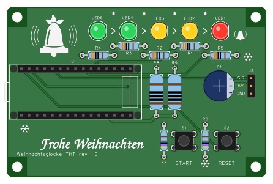 | 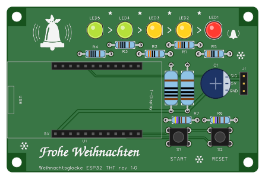 |

Bevor das Modul Strom bekommt, prüfst du jede Verbindung, die später zählt: Versorgung, die fünf LED-Strecken, die
Taster und die Leitungen vom Modul zu J1. Ein Fehler, den du hier findest, kostet eine Lötstelle – mit Modul und
Servo dran sucht man länger. Zum Schluss misst du mit Modul die Spannungen.

**Ohne Modul ist die Platine stromlos – in 8.1 bis 8.4 misst du keine Spannung, sondern Widerstand (Ω), Diodentest
und Durchgang.** Das Messgerät schickt dabei selbst einen kleinen Prüfstrom durch die Schaltung. „5V“, „GND“, „3V3“
und „SIG“ sind in diesen Schritten die **Namen der Leitungen**, wie sie auf dem Druck an J1 stehen – nicht Spannungen,
die anliegen. „J1 5V gegen J1 GND“ heißt also: der Widerstand zwischen der 5V-Leitung und der GND-Leitung. Spannung
misst du erst in 8.5, mit Modul und USB.

**So misst du:**

- Schwarze Messleitung an COM, rote an V/Ω. In den Bildern ist **rot** die rote Spitze, **schwarz** die schwarze,
  **blau** zeigt zwei Punkte, zwischen denen Durchgang sein muss (Richtung egal).
- **In die Buchsen** der Modul-Leisten passt keine Messspitze. Steck ein abgeschnittenes Widerstandsbein hinein und
  halte die Spitze daran, oder klemm eine Krokoklemme dran.
- **J1** misst du oben an den Stiften: quadratisches Pad unten = GND, Mitte = 5V, oben = SIG.
- Die Bilder zeigen die bedruckte Seite, nur 8.5 die Rückseite (gespiegelt).
- Weicht ein Wert ab: Lötstellen der beteiligten Teile auf der Rückseite ansehen, nachlöten, neu messen.

### 8.1 · Versorgungsleitungen (ohne Modul, Widerstand)

> **Zustand:** Modul **draußen** · USB ab · Servo ab · Platine stromlos · Messgerät auf **Ω**

Hier prüfst du, ob zwischen der 5V- und der GND-Leitung ein Kurzschluss ist und ob R8 und R9 verlötet sind – bevor
das Modul je Strom bekommt. Zwischen den beiden Leitungen sitzen ohne Modul nur die Grundlast-Widerstände R8 und R9,
je 100 Ω, parallel: zusammen 50 Ω. Zeigt das Messgerät das, stimmt beides.

| THT | ESP32 THT |
|---|---|
| 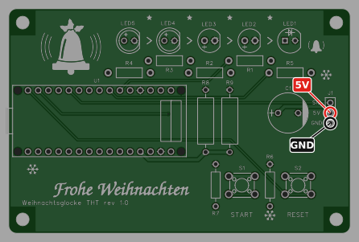 | 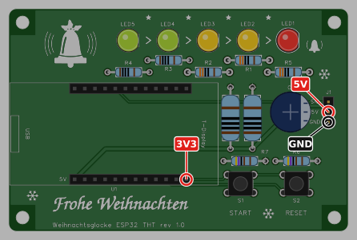 |

| Rot | Schwarz | Messbereich | Soll | Wenn nicht |
|---|---|---|---|---|
| J1-Stift 5V (Mitte) | J1-Stift GND (unten) | Ω | **≈ 50 Ω** (R8 ∥ R9). Der Wert pendelt sich in 1–2 s ein, weil sich C1 erst lädt | < 10 Ω: Lötbrücke auf 5V suchen. ≈ 100 Ω: R8 oder R9 nicht verlötet. Kein Wert: J1, R8 und R9 nachlöten |
| **[ESP32 THT]** Buchse 3V3 (untere Reihe, rechts) | J1 GND | Ω | **kein Durchgang** (OL) | Brücke an der 3V3-Buchse oder an S1/S2 suchen |
| **[ESP32 THT]** Buchse 3V3 | J1 5V | Ω | **kein Durchgang** (OL) | Brücke zwischen den beiden Reihen der Buchsenleiste |

**Zeigt das Messgerät unter 10 Ω zwischen 5V und GND, darf das Modul nicht in die Buchse.** Es würde sonst den
Kurzschluss über seinen USB-Anschluss speisen. Erst die Lötbrücke suchen.

### 8.2 · LEDs (Diodentest)

> **Zustand:** Modul **draußen** · USB ab · Servo ab · Platine stromlos · Messgerät auf **Diodentest** (▶|)

Hier prüfst du die fünf LED-Strecken – Vorwiderstand, LED, ihre Polung und die Lötstellen – von der Buchse des Moduls
bis GND. Der kleine Prüfstrom des Messgeräts lässt jede LED schwach glimmen.

| THT | ESP32 THT |
|---|---|
| 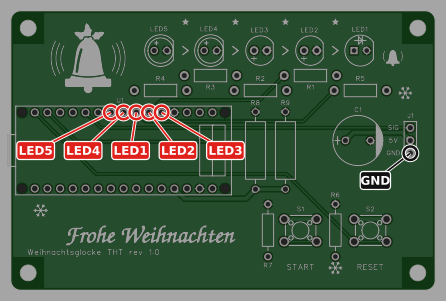 | 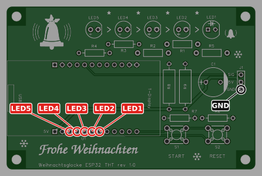 |

Schwarz bleibt an J1 GND, rot nacheinander in die fünf Buchsen. **[THT]** Die Buchsen liegen nicht in der Reihenfolge
der LEDs: von links LED5, LED4, LED1, LED2, LED3 – so wie die Schilder im Bild.

| Rot in Buchse | Strecke | Soll |
|---|---|---|
| LED5 | R4 → LED5 | Anzeige etwa **1,7–2,6 V**, die LED glimmt schwach |
| LED4 | R3 → LED4 | wie LED5 |
| LED3 | R2 → LED3 | wie LED5 |
| LED2 | R1 → LED2 | wie LED5 |
| LED1 | R5 → LED1 | wie LED5 |

- **[THT]** Die grünen LEDs (LED5, LED4) brauchen mehr Spannung: etwa 2,6–3,2 V, oder **OL**, wenn die Prüfspannung
  deines Messgeräts nicht reicht. Dann prüfst du sie beim ersten Strom (Schritt 9).
- Glimmt eine **andere** LED als die in der Tabelle: Du bist in der Buchse daneben – im Bild nachzählen. Glimmt die
  richtige Stelle in der falschen Farbe, sind zwei LEDs vertauscht (Tabelle in Schritt 5).
- **OL** bei einer einzelnen roten, gelben oder gelbgrünen LED: LED verkehrt herum (langes Bein muss links), oder
  eine Lötstelle an LED oder Vorwiderstand ist kalt.
- **OL bei allen fünf**, auch bei der roten: Die Prüfspannung deines Messgeräts ist zu klein für LEDs. Dann zeigt
  sich in Schritt 9, ob sie leuchten.
- **Gegenprobe:** Spitzen tauschen (schwarz in die Buchse, rot an GND): jetzt muss bei allen fünf **OL** stehen.
  Steht ein Wert, hat die Strecke eine Brücke nach GND.

### 8.3 · Taster

> **Zustand:** Modul **draußen** · USB ab · Servo ab · Platine stromlos · Messgerät auf **Ω**

Hier prüfst du, ob START und RESET schalten, ob jeder an der richtigen Buchse ankommt und ob die Pull-downs R6 und R7
sitzen. Jede Messung zweimal: Taster los, dann gedrückt.

| THT | ESP32 THT |
|---|---|
| 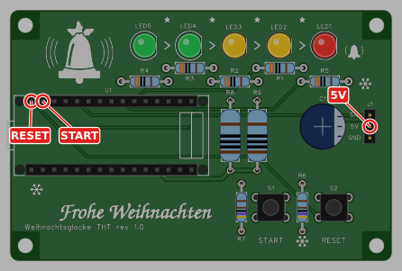 | 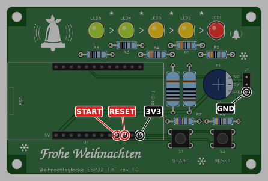 |

**[THT]** – die Taster schalten 5V. Bei losgelassenem Taster misst du den Weg von der Buchse über den Pull-down
nach GND und von dort über R8 ∥ R9 nach 5V: 4,7 kΩ + 50 Ω.

| Rot | Schwarz | Taster los | gedrückt |
|---|---|---|---|
| Buchse START | J1 5V | ≈ 4,75 kΩ (R7 + R8 ∥ R9) | START: **≈ 0 Ω**. RESET drücken ändert nichts |
| Buchse RESET | J1 5V | ≈ 4,75 kΩ (R6 + R8 ∥ R9) | RESET: **≈ 0 Ω**. START drücken ändert nichts |

**[ESP32 THT]** – die Taster schalten 3V3. Der Pull-down führt hier von der Buchse nach GND, deshalb zwei Messungen
mehr:

| Rot | Schwarz | Taster los | gedrückt |
|---|---|---|---|
| Buchse START | Buchse 3V3 | OL | START: **≈ 0 Ω**. RESET drücken ändert nichts |
| Buchse RESET | Buchse 3V3 | OL | RESET: **≈ 0 Ω**. START drücken ändert nichts |
| Buchse START | J1 GND | ≈ 4,7 kΩ (R7) | – |
| Buchse RESET | J1 GND | ≈ 4,7 kΩ (R6) | – |

Wenn nicht: Bleibt der Wert beim Drücken gleich, Taster-Lötstellen nachlöten. Stimmt der Wert „los“ nicht, ist es der
Pull-down (R7 bzw. R6) – Wert nachmessen, ob dort 4,7 kΩ sitzt (gelb – violett – schwarz – braun – braun).

### 8.4 · Modul-Buchsen zu J1 (Durchgang)

> **Zustand:** Modul **draußen** · USB ab · Servo ab · Platine stromlos · Messgerät auf **Durchgang** (piepst)

Hier prüfst du die drei Leitungen vom Modul zum Servo-Stecker J1: 5V, GND und das Servo-Signal. Und dass das Signal
keine Verbindung zu 5V oder GND hat.

| THT | ESP32 THT |
|---|---|
| 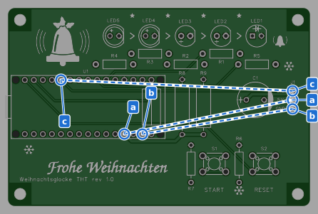 | 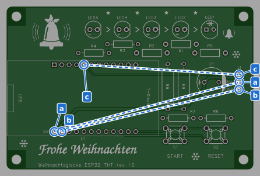 |

Die blauen Paare:

| Paar | Buchse | J1 | Soll |
|---|---|---|---|
| a | 5V | 5V (Mitte) | piepst (< 1 Ω) |
| b | GND | GND (unten, quadratisch) | piepst |
| c | Servo-Signal | SIG (oben) | piepst |

Zur Sicherheit die Querprobe: SIG gegen 5V und SIG gegen GND an J1 – beide **kein** Piepen.

### 8.5 · Mit Modul: die Spannungen

> **Zustand:** Modul **drin** · USB **an** (Netzteil, Powerbank oder Rechner) · Servo ab · Messgerät auf **V DC**

Hier prüfst du mit Strom, ob die 5 V des Moduls auf der Platine ankommen und beim T-Display der 3,3-V-Regler läuft. Erst
jetzt, wenn 8.1–8.4 gepasst haben, bekommt die Platine Strom.

> **Achtung – Spannung liegt an.** Nicht an J1 messen: Dort liegt 5V direkt zwischen GND und SIG, ein Ausrutscher
> kann das Modul kosten. Gemessen wird an den Beinen von R9.

In dieser Reihenfolge:

1. USB ist ab. **Modul einstecken** wie in Schritt 7, Punkt 1 – USB-Buchse links, beim T-Display Display nach oben und
   der 5V-Pin am Aufdruck „5V“.
2. Servo bleibt **ab**.
3. **USB anstecken:** an ein USB-Netzteil, eine Powerbank oder den Rechner. Beim T-Display geht das Display an (oder
   bleibt dunkel, wenn noch keine Firmware drauf ist – beides ist hier in Ordnung), der Nano lässt seine Power-LED
   leuchten.
4. Messen. Die 5 V oben an den Beinen von R9, dort wo sie aus dem Körper kommen. Die 3V3-Lötstelle des T-Displays
   misst du auf der Rückseite, mit eingestecktem Modul: Platine hochkant halten und abstützen, damit sie beim
   Aufsetzen der Spitzen nicht wegrutscht.

| Rot | Schwarz | Soll | Wenn nicht |
|---|---|---|---|
| R9, unteres Bein (zu den Tastern) | R9, oberes Bein (zu den LEDs) | **4,4–5,0 V** (USB minus die Schutzdiode des Moduls) | Schwaches Netzteil oder dünnes Kabel – ein anderes probieren |
| **[ESP32 THT]** Lötstelle 3V3 auf der Rückseite (Bild „Rückseite“) | Lötstelle des oberen Beins von R9, ebenfalls auf der Rückseite | **3,2–3,4 V** (der Regler des T-Displays) | USB ab, Modul ziehen, 8.1 wiederholen |
| Fingerprobe nach 1 min: alle Teile kurz anfassen | – | R8 und R9 handwarm (≈ 0,1 A), alles andere kalt | Wird etwas heiß: sofort USB ab, Modul ziehen, 8.1 wiederholen |

| THT | ESP32 THT |
|---|---|
| 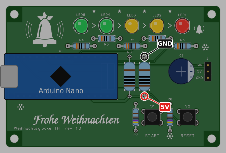 | 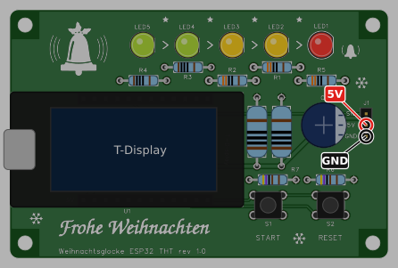 |
| Rückseite: nichts zu messen | Rückseite: 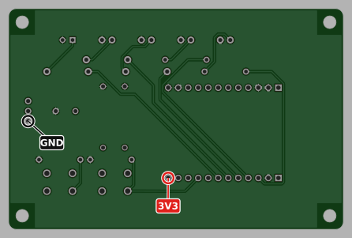 |

## 9 · Firmware und Test

> **Zustand:** Modul drin · USB **am Rechner** · Servo ab – erst ab Punkt 4 kommt das Servo dran, und dafür zuerst USB ab

Das Modul steckt seit 8.5 und bleibt drin. Hast du dort an einem Netzteil oder einer Powerbank gemessen: USB ab, dann
das USB-Kabel vom Rechner an die USB-Buchse des Moduls.

### [THT] Arduino Nano

```bash
pio run -e nano -t upload           # im Repository; scheitert es: -e nano_new (neuer Bootloader)
pio device monitor                  # 115200 Baud
```

Soll:

1. Nach dem Start schreibt der Nano `setup` und seine Einstellungen, **alle fünf LEDs leuchten**.
2. **START** drücken: `pressed A`, `countdown started`. Die LEDs zeigen die Restzeit: LED5 links blinkt 12 s und
   geht aus, dann LED4 – bis LED1 rechts. Die LEDs rechts von der blinkenden leuchten noch. Bleibt eine dunkel:
   Polung und Wert in Schritt 2 und 5 nachsehen.
3. **RESET** drücken: `pressed B`, `countdown reset`, alle LEDs wieder an.
4. USB ab, **Servo an J1**: braun unten an GND, rot Mitte, orange oben an SIG. USB wieder an.
5. **START halten und RESET drücken:** Die Glocke läutet sofort – das Servo schwingt sechsmal, fährt in die
   Ruhestellung und ist 1 s später abgeschaltet (`servo detached`).
6. Einmal ganz: START drücken und warten. Nach 60 s blinken alle fünf LEDs 5 s lang, dann läutet es und die LEDs
   sind aus.
7. Fertig: USB ab. Im Betrieb versorgt ein USB-Netzteil oder eine Powerbank die Glocke über dieselbe Buchse.

### [ESP32 THT] T-Display

```bash
cd variants/esp32/firmware
pio run -e tdisplay -t upload       # über die USB-C-Buchse des Moduls
```

Soll:

1. Das Display zeigt den Hotspot `Glocke-XXXX` mit Passwort. Einrichtung wie im [README](../README.md#-variante-esp32-display-und-webseite).
2. **START:** Der Countdown läuft auf Display und LEDs. **RESET:** Stopp.
3. **RESET 3 s halten:** Die gelbgrünen LEDs leuchten, solange du hältst (WLAN an/aus). Loslassen schaltet um –
   ein zweites Mal halten schaltet zurück.
4. USB ab, **Servo an J1** wie oben (braun unten an GND). Versorgen mit Netzteil oder Powerbank (≥ 1 A, A-auf-C-Kabel;
   bleibt das Modul an C-auf-C dunkel, den Stecker umdrehen).
5. **START halten und RESET drücken:** Die Glocke läutet sofort.
6. Einmal ganz: START drücken und warten, nach 65 s läutet es.
7. Fertig: USB ab. Im Betrieb versorgt ein USB-Netzteil oder eine Powerbank (≥ 1 A) die Glocke über dieselbe Buchse.

Den LiPo-Anschluss des T-Displays frei lassen – R8 und R9 würden einen Akku leeren.

### Wenn etwas nicht geht

| Befund | Ursache, meist |
|---|---|
| Eine LED bleibt dunkel | verkehrt herum (langes Bein muss links) oder Vorwiderstand nicht gelötet |
| Upload schlägt fehl [THT] | anderer Bootloader: `-e nano_new`; Kabel ohne Datenleitungen |
| START startet nicht, RESET schon | Lötstellen an S1 und an seinem Pull-down R7 prüfen, Messung 8.3 wiederholen. Die Taster selbst sind gleich, vertauschen kann man sie nicht |
| Modul startet neu, sobald das Servo läuft | C1 fehlt oder ist kalt gelötet; schwache USB-Quelle (README, Troubleshooting) |
| Powerbank schaltet ab | R8 oder R9 nicht gelötet: Messung 8.1 wiederholen |

### Prüfprotokoll

Zum Ausdrucken, eins je Platine. Abhaken, wenn der Sollwert stimmt, und die Messwerte eintragen – dann siehst du
später, wenn eine Glocke Ärger macht, wie sie am Anfang war. Zeilen mit **[THT]** oder **[ESP32 THT]** gelten nur
für diese Platine, bei der anderen streichen.

**Platine:** ☐ THT ☐ ESP32 THT  **Nummer (1–5):** ……… **Datum:** ………………

**A · Nach dem Löten** – Modul draußen · USB ab · Servo ab

| Schritt | Prüfung | Soll | Gemessen | ✓ |
|---|---|---|---|:-:|
| 1 | Leere Platine: J1-Pads 5V gegen GND | kein Durchgang | – | ☐ |
| 2 | [ESP32 THT] R3, R4 = 100 Ω, alle anderen Vorwiderstände 330 Ω; [THT] alle fünf 330 Ω | Ringe wie Tabelle | – | ☐ |
| 3 | R8, R9 stehen 1–2 mm über der Platine | | – | ☐ |
| 5 | LEDs: langes Bein links, Abflachung rechts, alle plan, Farben wie Tabelle | | – | ☐ |
| 6 | C1: „+“ links, Streifen rechts zu J1 | | – | ☐ |
| 7 | Buchsenleisten plan und gerade, Modul passt ohne Spannung | | – | ☐ |
| 2–7 | Alle Lötstellen glänzend und kegelförmig, keine Brücken, Beine gekürzt | | – | ☐ |

**B · Messen ohne Modul** – Modul draußen · USB ab · Servo ab · Widerstand, Diodentest, Durchgang – keine Spannung

| Schritt | Prüfung | Soll | Gemessen | ✓ |
|---|---|---|---|:-:|
| 8.1 | J1 5V gegen J1 GND | ≈ 50 Ω | Ω | ☐ |
| 8.1 | [ESP32 THT] Buchse 3V3 gegen J1 GND | OL | | ☐ |
| 8.1 | [ESP32 THT] Buchse 3V3 gegen J1 5V | OL | | ☐ |
| 8.2 | Diodentest Buchse LED5 gegen GND | 1,7–2,6 V, glimmt ([THT] grün: bis 3,2 V oder OL) | V | ☐ |
| 8.2 | Diodentest Buchse LED4 gegen GND | wie LED5 | V | ☐ |
| 8.2 | Diodentest Buchse LED3 gegen GND | 1,7–2,6 V, glimmt | V | ☐ |
| 8.2 | Diodentest Buchse LED2 gegen GND | 1,7–2,6 V, glimmt | V | ☐ |
| 8.2 | Diodentest Buchse LED1 gegen GND | 1,7–2,6 V, glimmt | V | ☐ |
| 8.2 | Gegenprobe, Spitzen getauscht, alle fünf | OL | – | ☐ |
| 8.3 | Buchse START: los / START gedrückt | [THT] ≈ 4,75 kΩ / ≈ 0 Ω gegen 5V · [ESP32 THT] OL / ≈ 0 Ω gegen 3V3 | / | ☐ |
| 8.3 | Buchse RESET: los / RESET gedrückt | wie START | / | ☐ |
| 8.3 | Der jeweils andere Taster ändert nichts | | – | ☐ |
| 8.3 | [ESP32 THT] Buchse START bzw. RESET gegen J1 GND | je ≈ 4,7 kΩ | / | ☐ |
| 8.4 | Durchgang Buchse → J1: a 5V · b GND · c SIG | piepst | ☐a ☐b ☐c | ☐ |
| 8.4 | Querprobe an J1: SIG gegen 5V, SIG gegen GND | kein Piepen | – | ☐ |

**C · Mit Modul** – Modul drin · USB an · Servo ab

| Schritt | Prüfung | Soll | Gemessen | ✓ |
|---|---|---|---|:-:|
| 8.5 | Modul richtig herum: USB links; [ESP32 THT] Display oben, 5V-Pin am Aufdruck „5V“ | | – | ☐ |
| 8.5 | R9: unteres Bein (5V) gegen oberes Bein (GND) | 4,4–5,0 V | V | ☐ |
| 8.5 | [ESP32 THT] Lötstelle 3V3 gegen GND, Rückseite | 3,2–3,4 V | V | ☐ |
| 8.5 | Nach 1 min: nichts heiß, R8 und R9 handwarm | | – | ☐ |

**D · Firmware und Funktion** – Modul drin · USB am Rechner · Servo erst ab „Servo“, vorher USB ab

| Schritt | Prüfung | Soll | ✓ |
|---|---|---|:-:|
| 9 | Firmware aufgespielt | ohne Fehlermeldung | ☐ |
| 9 | [THT] Nach dem Start | alle fünf LEDs leuchten | ☐ |
| 9 | [ESP32 THT] Nach dem Start | Display zeigt den Hotspot `Glocke-XXXX` | ☐ |
| 9 | START drücken | Countdown läuft, LEDs blinken von LED5 nach LED1 | ☐ |
| 9 | RESET drücken | Countdown stoppt | ☐ |
| 9 | [ESP32 THT] RESET 3 s halten | gelbgrüne LEDs leuchten, WLAN schaltet um | ☐ |
| 9 | Servo an J1: braun unten an GND | | ☐ |
| 9 | START halten, RESET drücken | Glocke läutet sofort, Servo danach in Ruhe | ☐ |
| 9 | START drücken und warten | nach 65 s läutet es | ☐ |
| 9 | [ESP32 THT] Heimnetz eingerichtet | <http://glocke.local> öffnet sich | ☐ |
| 9 | USB ab | | ☐ |

**Ergebnis:** ☐ in Ordnung ☐ nachgearbeitet: …………………………………………………………………
