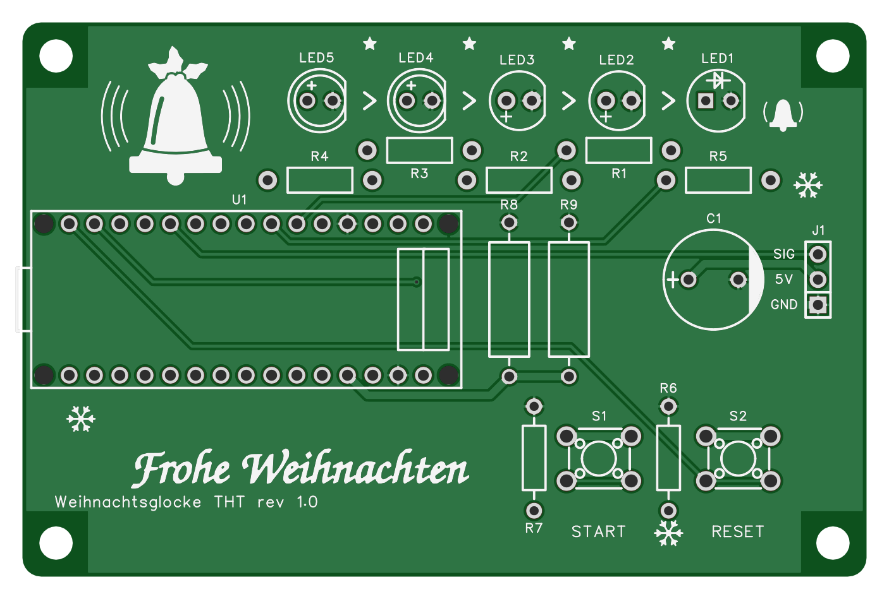
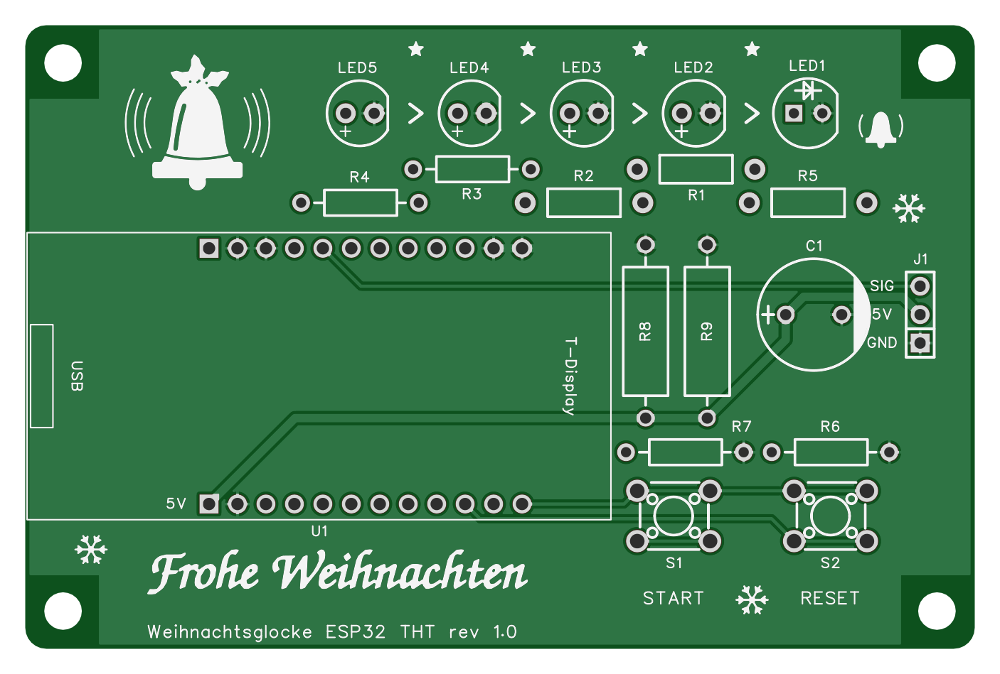

# Aufbau der THT-Glocke – löten und in Betrieb nehmen

Was nach der Lieferung von JLCPCB noch zu tun ist, Schritt für Schritt: welches Teil wann, wie herum und wie gelötet
wird, was du vor dem ersten Strom misst und wie du die Glocke danach prüfst. Gilt für die beiden bestellten
Platinen, die unbestückt kommen – alles wird von Hand gelötet:

- **THT** (Arduino Nano) – [variants/tht](../variants/tht), Entscheidung D-12
- **ESP32 THT** (LILYGO T-Display) – [variants/esp32tht](../variants/esp32tht), Entscheidung D-23

Beide haben dieselbe Lage aller Teile außer Modul U1 und den Pull-downs R6/R7. Was nur für eine Platine gilt, steht
mit **[THT]** oder **[ESP32 THT]** dabei. Die Bilder sind die Ansichten der bestellten Fassung (rev 1.0).

| THT (Nano) | ESP32 THT (T-Display) |
|---|---|
|  |  |

**Richtungen:** „oben“, „unten“, „links“, „rechts“ meinen immer den Blick auf die **bedruckte Seite** wie im Bild –
LED-Reihe oben, USB-Ende des Moduls links, J1 rechts. Alle Teile stecken von der bedruckten Seite, gelötet wird auf
der Rückseite. Dort ist links und rechts vertauscht und es gibt keinen Druck
([THT](img/aufbau_tht_unten.png), [ESP32 THT](img/aufbau_esp32tht_unten.png)).

Zum Ausdrucken baut `uv run docs/aufbau_pdf.py 2>&1 | cat` diese Seite als `build/aufbau/aufbau.pdf`.

**Zeit:** ≈ 1 h je Platine, dazu ≈ 15 min für Firmware und Test.

## Was du lötest

Die LCSC-Nummer steht auf jedem Sackerl der Lieferung.

| Teil | Bezeichner | THT | ESP32 THT | je Platine |
|---|---|---|---|---:|
| Widerstand ¼ W, Vorwiderstand LED | R1, R2, R5 | 330 Ω – C58608 | 330 Ω – C58608 | 3 |
| Widerstand ¼ W, Vorwiderstand LED | R3, R4 | 330 Ω – C58608 | **100 Ω – C57438** | 2 |
| Widerstand ¼ W, Pull-down Taster | R6, R7 | 4,7 kΩ – C57204 | 4,7 kΩ – C57204 | 2 |
| Widerstand 1 W, Grundlast für Powerbanks | R8, R9 | 100 Ω – C119469 | 100 Ω – C119469 | 2 |
| Taster 6 × 6 mm | S1 (START), S2 (RESET) | C110153 | C110153 | 2 |
| LED 5 mm grün | LED5, LED4 | grün XL-504UGD – C2895549 | **gelbgrün XL-504SYGD – C2895551** | 2 |
| LED 5 mm gelb | LED3, LED2 | XL-504UYD – C2895495 | XL-504UYD – C2895495 | 2 |
| LED 5 mm rot | LED1 | XL-504SURD – C2895493 | XL-504SURD – C2895493 | 1 |
| Stiftleiste 1 × 3, Servo | J1 | C2937625 | C2937625 | 1 |
| Elko 1000 µF / 16 V, Ø 10 mm | C1 | C439782 | C439782 | 1 |
| Buchsenleiste 2,54 mm, 8,5 mm hoch | für U1 | 2 × 1×15 – C25503121 | 2 × 1×12 – C2905419 | 2 |
| Modul | U1 | Arduino Nano V3 – nicht von LCSC | LILYGO T-Display V1.1 – nicht von LCSC | 1 |

Die Buchsenleisten sind Extras der Bestellung, nicht im Graph. Schneidest du sie aus den gekerbten 1×40-Leisten
(LCSC C2916940), geht an jeder Schnittstelle ein Kontakt verloren: aus einer Leiste werden 2 × 15 oder 3 × 12. Die
Schnittkante mit Feile oder Schleifpapier glätten.

**Widerstände nicht verwechseln.** Die ¼-W-Widerstände sind 1 %-Metallschicht mit fünf Ringen. Auf dem blauen Körper
sind die Farben schwer zu lesen – miss jeden vor dem Einsetzen kurz nach:

| Wert | Ringe | wo |
|---|---|---|
| 100 Ω | <br>braun – schwarz – schwarz – schwarz – braun | [ESP32 THT] R3, R4; die dicken 1-W-Widerstände R8, R9 auf beiden Platinen |
| 330 Ω | <br>orange – orange – schwarz – schwarz – braun | R1, R2, R5; [THT] auch R3, R4 |
| 4,7 kΩ | <br>gelb – violett – schwarz – braun – braun | R6, R7 |

## Polung – drei Teile, auf die es ankommt

- **LEDs:** das **lange Bein (Anode, +) nach links**, die abgeflachte Seite des Rands und das kurze Bein nach rechts.
  Das gilt für alle fünf, auch wenn die Drucke verschieden aussehen. Achtung bei **LED1 (rot):** Ihr **quadratisches
  Pad ist die Anode** – anders als bei vielen anderen Platinen, wo das Quadrat die Kathode markiert. Verkehrt herum
  leuchtet eine LED einfach nicht, kaputt geht nichts.
- **C1:** das **„+“ nach links** (längeres Bein), der helle Streifen mit „–“ auf dem Becher nach rechts zu J1.
  Verkehrt herum kann ein Elko platzen.
- **Modul U1:** USB-Buchse nach links an die Platinenkante (Schritt 7). Verkehrt eingesteckt schließt es 5 V kurz.

Keine Polung haben Widerstände und Taster. Die Taster passen nur in zwei Lagen in ihre Löcher, beide sind richtig.

## Werkzeug und Material

- Lötkolben mit feiner Spitze, ≈ 330 °C, Lot mit Flussmittelseele 0,5–0,8 mm.
- Seitenschneider, Flachzange, Pinzette, Multimeter mit Widerstands- und Durchgangsmessung.
- Ein Streifen Karton, ≈ 1,5 mm dick, als Abstandhalter für R8 und R9 (Schritt 3).
- Ein Stück Schaumstoff oder ein Buch, damit die Teile beim Umdrehen nicht herausfallen.
- Ein Servo SG90 (analog) und ein USB-Netzteil oder eine Powerbank mit mindestens 1 A.
- Rechner mit dem Repository und PlatformIO (`pio`), ein USB-Kabel mit Datenleitungen zum Modul.

## Reihenfolge

| Schritt | Was | ≈ min |
|---|---|---:|
| 1 | Sichtprüfung der Platine | 5 |
| 2 | Widerstände R1–R7, flach | 15 |
| 3 | R8, R9 mit Abstand | 5 |
| 4 | Taster S1, S2 | 5 |
| 5 | LEDs | 10 |
| 6 | J1 und C1 | 5 |
| 7 | Buchsenleisten mit dem Modul als Lehre | 15 |
| 8 | Messen ohne Modul | 5 |
| 9 | Firmware und Test | 15 |

Von flach nach hoch: So liegt die Platine beim Umdrehen immer auf den zuletzt gesteckten, höchsten Teilen auf, und
alles bleibt plan.

## 1 · Sichtprüfung

Platine gegen das Licht halten: keine Brücken zwischen Pads, alle Löcher offen, Aufdruck „Weihnachtsglocke THT rev 1.0“
bzw. „Weihnachtsglocke ESP32 THT rev 1.0“ unten links. Miss einmal zwischen dem mittleren Pad von J1 („5V“) und dem
quadratischen Pad von J1 („GND“): **kein Durchgang**. Ein Kurzschluss, den du jetzt findest, kommt von JLCPCB und
nicht von dir.

## 2 · Widerstände R1–R7

Die Beine knapp hinter dem Körper auf das Raster **10,5 mm** biegen, den Widerstand flach auf die Platine legen.
Werte nach der Tabelle oben – auf der ESP32 THT sind **R3 und R4 100 Ω**, alle anderen Vorwiderstände 330 Ω.

- R1–R5 liegen versetzt in zwei Reihen unter den LEDs.
- **[THT]** R6 und R7 stehen senkrecht links neben ihren Tastern. **[ESP32 THT]** liegen sie waagrecht über den
  Tastern.

Alle sieben stecken, Beine auf der Rückseite leicht auseinanderbiegen, damit nichts herausfällt, umdrehen, löten,
Beine kürzen.

## 3 · R8 und R9 – Grundlast

Die beiden dicken 1-W-Widerstände (100 Ω) stehen senkrecht zwischen Modul und C1, Beine auf das Raster **15,5 mm**.
Sie werden im Betrieb warm (je ≈ 0,25 W, D-8). Deshalb liegen sie nicht auf: den Kartonstreifen unter den Körper
legen, löten, Karton herausziehen. Der Körper steht dann 1–2 mm über der Platine.

## 4 · Taster S1 und S2

S1 ist START (links), S2 ist RESET (rechts). Die Löcher sind 1,3 mm groß und damit weiter als die Beine: Drücke jeden
Taster beim Löten des ersten Beins **plan auf die Platine**, prüfe den Sitz, dann die anderen drei Beine.

## 5 · LEDs

Farben von links nach rechts – so blinkt auch der Countdown:

| | LED5 | LED4 | LED3 | LED2 | LED1 |
|---|---|---|---|---|---|
| THT | grün | grün | gelb | gelb | rot |
| ESP32 THT | gelbgrün | gelbgrün | gelb | gelb | rot |

1. Alle fünf stecken, **langes Bein links** (Polung oben). Den Rand der LED plan auf die Platine.
2. Schaumstoff oder Buch auf die LEDs legen, mit der Platine zusammen umdrehen.
3. Je LED **ein** Bein löten. Umdrehen und prüfen: stehen alle gerade und gleich hoch? Wenn nicht, die Lötstelle kurz
   erhitzen und die LED nachdrücken. Dann das zweite Bein löten und kürzen.

Wer sicher gehen will: Multimeter auf Diodentest, rote Spitze ans linke Bein, schwarze ans rechte – die LED glimmt
bei den meisten Messgeräten schwach.

## 6 · J1 und C1

- **J1** (Servo): die kurzen Enden der Stiftleiste in die Platine. Ein Bein löten, prüfen, ob die Leiste senkrecht
  steht, dann die anderen. Belegung laut Druck: **GND unten** (quadratisches Pad), 5V Mitte, SIG oben.
- **C1:** „+“ nach links (Polung oben), plan auf die Platine, löten, kürzen.

## 7 · Buchsenleisten mit dem Modul als Lehre

Die Buchsenleisten werden mit eingestecktem Modul gelötet – dann stehen sie gerade und das Modul passt später ohne
Spannung.

**Hat das Modul noch keine Stiftleisten** (beim T-Display meist lose beigelegt): Die Platine dient als Lehre.

1. Die Buchsenleisten in die Platine stecken (nicht löten).
2. Die Stiftleisten mit dem **langen Ende** in die Buchsenleisten stecken.
3. Das Modul auf die kurzen Enden setzen – **[THT]** Bauteile nach oben, **[ESP32 THT]** **Display nach oben**.
   Die Stifte oben **am Modul** löten, beim T-Display mit der Spitze nicht ans Display kommen.

**Dann die Buchsenleisten**, ob mit fertigem Modul oder nach den Punkten oben:

1. Modul samt Buchsenleisten in die Platine stecken, **USB-Buchse links** an der Platinenkante.
   - **[THT]** Der Nano liegt im Rechteck „U1“, seine USB-Buchse ragt links über die Kante. Prüfe an seinem
     Aufdruck: Die Reihe mit TX, RX und D2…D12 liegt **oben** (zu den LEDs), D12 links an der USB-Seite; die Reihe
     mit D13, A0…A7, 5V und VIN unten. Liegt der Nano verkehrt auf dem Rücken, sind die Reihen vertauscht.
   - **[ESP32 THT]** Display nach oben, USB-C links (Druck „USB“). Das quadratische Loch unten links mit dem Druck
     **„5V“** ist der 5V-Pin des Moduls – prüfe am Aufdruck des Moduls, dass dort sein 5V-Stift steckt. Das Pin-Feld
     ist symmetrisch: Umgedreht passt das Modul auch hinein und schließt dann 5V gegen GND kurz.
2. Umdrehen, je Leiste einen Eckkontakt löten. Prüfen: Liegen beide Leisten plan auf der Platine? Wenn nicht,
   nachwärmen und nachdrücken. Dann den Kontakt in der Ecke gegenüber, noch einmal prüfen, dann alle übrigen.
3. Modul abziehen.

## 8 · Messen ohne Modul

Modul ab, Multimeter auf Widerstand. Gemessen wird an J1: mittleres Pad (5V) gegen quadratisches Pad (GND).

| Messung | Soll | Was es zeigt |
|---|---|---|
| J1 5V gegen GND | ≈ 50 Ω, steigt erst kurz an (C1 lädt sich) | R8 ∥ R9 sitzen, kein Kurzschluss auf 5V |
| **[ESP32 THT]** Buchse unten rechts (letzte der unteren Reihe, 3V3) gegen J1 GND | kein Durchgang; mit gedrücktem START oder RESET ≈ 4,7 kΩ | 3V3 frei, Taster und R6/R7 in Ordnung |

Unter 10 Ω zwischen 5V und GND: Lötbrücke suchen, bevor das Modul Strom bekommt.

## 9 · Firmware und Test

Das Modul einstecken (Schritt 7, Punkt 1), USB an den Rechner. Servo noch nicht anstecken.

### [THT] Arduino Nano

```bash
pio run -e nano -t upload           # im Repository; scheitert es: -e nano_new (neuer Bootloader)
pio device monitor                  # 115200 Baud
```

Soll:

1. Nach dem Start schreibt der Nano `setup` und seine Einstellungen, **alle fünf LEDs leuchten**.
2. **START** drücken: `pressed A`, `countdown started`. Die LEDs blinken nacheinander je 12 s, von LED5 links bis
   LED1 rechts. Leuchtet keine oder eine falsche LED: Polung und Wert in Schritt 2 und 5 nachsehen.
3. **RESET** drücken: `pressed B`, `countdown reset`, alle LEDs wieder an.
4. USB ab, **Servo an J1**: braun unten an GND, rot Mitte, orange oben an SIG. USB wieder an.
5. **START halten und RESET drücken:** Die Glocke läutet sofort – das Servo schwingt sechsmal, fährt in die
   Ruhestellung und ist 1 s später abgeschaltet (`servo detached`).
6. Einmal ganz: START drücken und warten, nach 65 s läutet es.

### [ESP32 THT] T-Display

```bash
cd variants/esp32/firmware
pio run -e tdisplay -t upload       # über die USB-C-Buchse des Moduls
```

Soll:

1. Das Display zeigt den Hotspot `Glocke-XXXX` mit Passwort. Einrichtung wie im [README](../README.md#-variante-esp32-display-und-webseite).
2. **START:** Der Countdown läuft auf Display und LEDs. **RESET:** Stopp.
3. **RESET 3 s halten:** Die gelbgrünen LEDs leuchten, solange du hältst (WLAN an/aus). Loslassen schaltet um –
   ein zweites Mal halten schaltet zurück.
4. USB ab, **Servo an J1** wie oben (braun unten an GND). Versorgen mit Netzteil oder Powerbank (≥ 1 A, A-auf-C-Kabel;
   bleibt das Modul an C-auf-C dunkel, den Stecker umdrehen).
5. **START halten und RESET drücken:** Die Glocke läutet sofort.

Den LiPo-Anschluss des T-Displays frei lassen – R8 und R9 würden einen Akku leeren (D-13).

### Wenn etwas nicht geht

| Befund | Ursache, meist |
|---|---|
| Eine LED bleibt dunkel | verkehrt herum (langes Bein muss links) oder Vorwiderstand nicht gelöst |
| Upload schlägt fehl [THT] | anderer Bootloader: `-e nano_new`; Kabel ohne Datenleitungen |
| START startet nicht, RESET schon | Taster vertauscht gesteckt? Beide sind gleich – dann Lötstelle an R6/R7 prüfen |
| Modul startet neu, sobald das Servo läuft | C1 fehlt oder ist kalt gelötet; schwache USB-Quelle (README, Troubleshooting) |
| Powerbank schaltet ab | R8 oder R9 nicht gelötet: Messung in Schritt 8 wiederholen |
