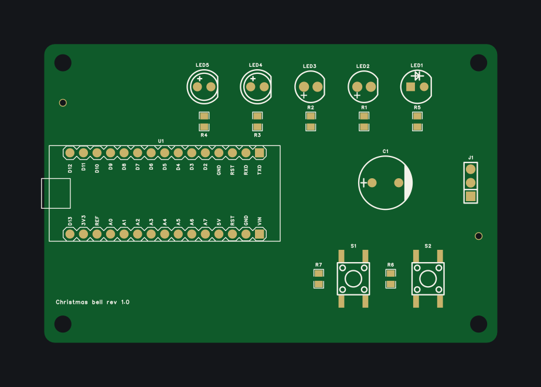
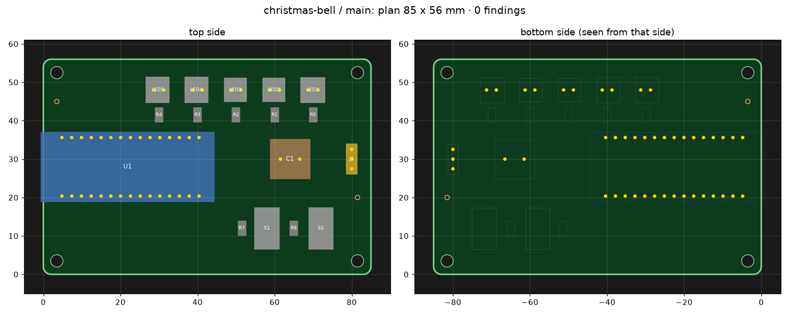
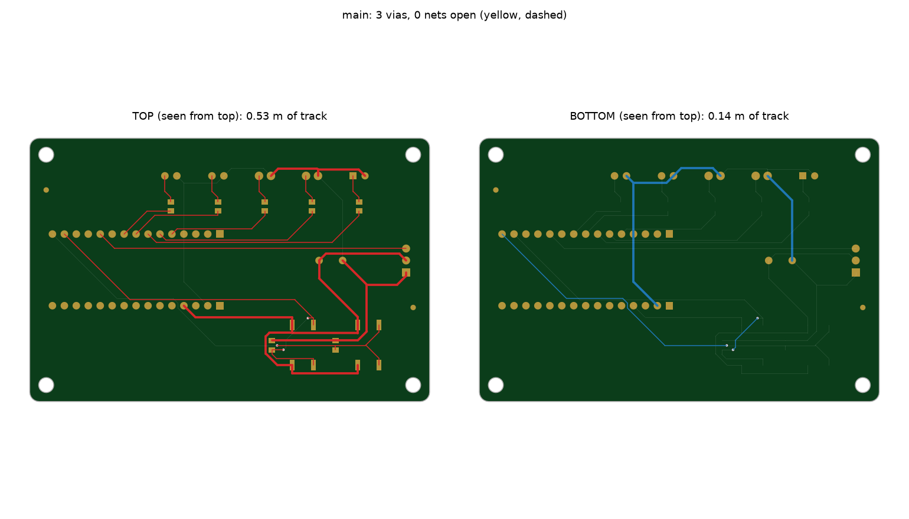

# The board

This folder holds the Christmas bell's carrier board as an [edakit](https://github.com/tgd1975/edakit)
project. It is the second board built with edakit and its public example.

It was not a push-button run:

- **Circuit:** It comes from the Fritzing drawing (`weihnachtsglocke.fzz`). The hardware graph, the parts database
  and the simulation scenarios were written for it, with Claude Code.
- **Gaps in edakit:** Taking it through EasyEDA Pro showed gaps that had to be developed first: pin names checked
  against the symbols, adopting the default board of a new project, LEDs in a row pointing the same way, off-board
  loads and input levels in the simulation, and a guard after a generated schematic once landed in the wrong EasyEDA
  project.
- **Manual steps:** Creating the EasyEDA project, one click on *Import Changes*, and every decision in
  [docs/decisions.md](../docs/decisions.md).

Generated is the content of the EasyEDA project: schematic, placement, tracks, copper pours and silkscreen come from
the files here and can be deleted and regenerated.



An Arduino Nano plugs into two female headers and is powered through its own USB socket. Its 5V pin feeds the servo
(J1) and the buffer capacitor C1. Five 5 mm LEDs show the countdown, two buttons start and reset it. JLCPCB places the
SMD parts (resistors, buttons); the headers, LEDs, C1 and J1 are hand-soldered.

| File | Content |
|---|---|
| [../edakit.toml](../edakit.toml) | the table of contents: EasyEDA project `christmas-bell`, the board `main`, where the files are, release |
| [boards/main.toml](boards/main.toml) | the board: 85 × 56 mm, holes, tooling holes, placement plan, routing rules, pours, silkscreen and artwork |
| [schematic.toml](schematic.toml) | the blocks, notes and pin table of the schematic |
| [graph.json](graph.json) | the hardware graph: 17 parts, 15 nets with voltage ranges, the pin locks for the firmware – the only source of the circuit |
| [parts/](parts/) | one entry per LCSC number: pins with roles, ratings, lead sizes, datasheet sign-off |
| [sim.json](sim.json) | USB at 4.45/4.7/5.05 V × idle, countdown, warning, bell × LED corners; a stalled servo as fault case |
| [signoff.json](signoff.json) | manual checks M-1, M-5, M-2, M-4 |
| [../docs/decisions.md](../docs/decisions.md) | numbered decisions D-1 … D-15 |
| [../variants](../variants/README.md) | three variants of this board: SMD, THT only, ESP32 with display (D-11 … D-15) |

## Offline

```bash
uvx --from git+https://github.com/tgd1975/edakit edakit check   # 0 errors, 1 waived (VIN unused)
uvx --from git+https://github.com/tgd1975/edakit edakit sim     # 1112 checks, 1 information (stalled servo)
```

## Through EasyEDA

The project was created by hand once (File → New → Project, `christmas-bell`); then:

```bash
edakit schematic create --save   # template from the graph: 17 parts, 15/15 nets, ERC 0
edakit schematic layout --save   # board schematic in blocks; adopts EasyEDA's default board as "main"
edakit pcb parts --write         # parts and nets into the PCB, no dialog
edakit pcb dump && edakit pcb plan
edakit pcb apply                 # outline, 4 M3 holes, 2 tooling holes, all 17 parts from the plan
edakit route all                 # Freerouting: 15 nets, 3 vias, pours, DRC 0
edakit silk apply                # 17/17 designators, no silkscreen on pads
edakit gate --easyeda            # release gate
```

One click in the GUI: *Design → Import Changes* once, which showed "no changes". That clears EasyEDA's DRC finding
"Netlist Error – Import Changes" for parts freshly placed from the library.

| Placement plan | Routing (top and bottom) |
|---|---|
|  |  |

## What the checks found

- **Simulation:**
  - A stalled servo draws about 810 mA, more than the Nano's polyfuse is sure to stop (D-3, fault case).
  - The circuit alone draws too little for USB power banks, so R8 ∥ R9 add a permanent 100 mA (D-8).
  - The buttons first switched 3.3 V into the 5 V ATmega, only 0.28 V above its input threshold. They now switch 5 V
    (D-4).
- **Pin names:**
  - The LED symbols and footprints of one library series disagree on which pad is the anode; the roles in `parts/`
    follow the footprint's "+" print.
  - The Nano symbol labels two pins the wrong way round. Only the labels are swapped (D-7); the connections go by pin
    number.
- **Placement:** LEDs in a row point the same way, so the yellow footprints, whose "+" sits on the other pad, are
  turned by 180°.
- **Holes:** The first Nano footprint had 0.9 mm holes, too small for the header tails. The one now used has 1.1 mm
  holes (D-7).
- **Reviews:**
  - The electrical review (M-1) was signed by an independent agent. It also found two firmware bugs, which are fixed.
  - The layout review (M-5) failed twice before it passed: printed texts below 1 mm, and copper too close to the
    mounting holes. Both were fixed in edakit itself.

**Released** on 2026-10-25, gate run 20261025-220549: every stage passes, M-1 and M-5 are signed. What remains is the
manufacturer's assembly preview (M-2) and the acceptance test of the delivered boards (M-4).
